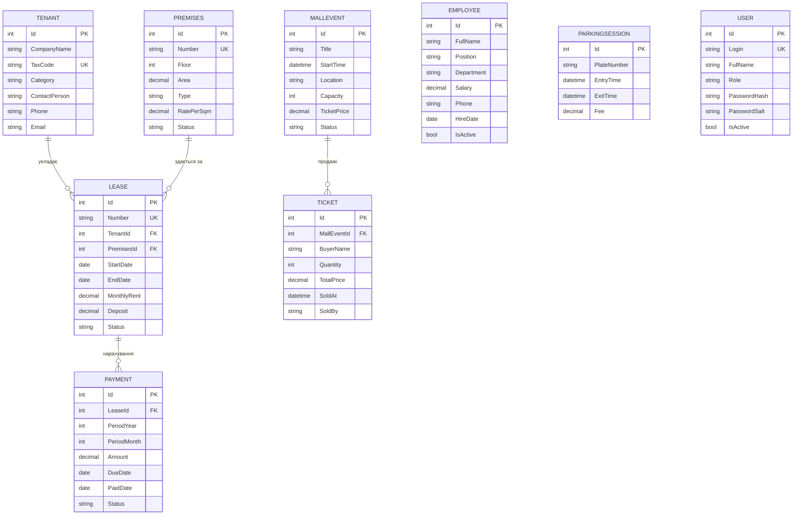

# Автоматизована система торгово-розважального центру (ТРЦ)

Курсовий проєкт: настільний застосунок на **C# (.NET 8, Windows Forms)** для автоматизації
роботи торгово-розважального центру «Галактика». Дані зберігаються в базі **SQLite**,
доступ до неї — через **Entity Framework Core**.

## Як відкрити та запустити у Visual Studio

1. Встановіть **Visual Studio 2022** (версія 17.8 або новіша) з робочим навантаженням
   **«Розробка класичних застосунків .NET» (.NET desktop development)**.
   Воно вже містить .NET 8 SDK.
2. Відкрийте файл рішення **`TrcSystem.sln`** (*File → Open → Project/Solution*).
3. Стартовий проєкт — **Trc.WinForms** (виділений жирним у *Solution Explorer*).
   Якщо ні — клацніть по ньому правою кнопкою → *Set as Startup Project*.
4. Натисніть **F5**. Під час першого запуску NuGet-пакети завантажаться автоматично
   (потрібен інтернет), а поруч із програмою (`bin\Debug\net8.0-windows\trc.db`)
   буде створена база даних із демонстраційними даними.

Щоб почати з «чистими» демо-даними, закрийте програму й видаліть файл `trc.db`.

### Облікові записи для входу

| Логін     | Пароль       | Роль          | Доступні розділи                          |
|-----------|--------------|---------------|-------------------------------------------|
| `admin`   | `admin123`   | Адміністратор | усі, включно з керуванням користувачами   |
| `manager` | `manager123` | Менеджер      | усі, крім «Користувачі»                   |
| `cashier` | `cashier123` | Касир         | «Головна», «Заходи та квитки», «Паркінг»  |

### Запуск з командного рядка (необов'язково)

```bash
dotnet run --project src/Trc.WinForms
```

```bash
dotnet test
```

## Функціональні можливості

| Розділ | Що вміє |
|---|---|
| **Головна** | ключові показники: заповненість ТРЦ, дохід від оренди, заборгованість, договори, що закінчуються, паркінг, заходи; список боржників і найближчих заходів |
| **Приміщення** | облік торгових площ (номер, поверх, тип, площа, ставка за м²), автоматичний розрахунок орендної плати, стан (вільне / орендоване / на ремонті), фільтр і пошук |
| **Орендарі** | облік орендарів з перевіркою коду ЄДРПОУ (8 цифр) / РНОКПП (10 цифр), телефону та e-mail |
| **Договори оренди** | укладання договору з автоматичною нумерацією (`Д-2026-001`), перевірка, що приміщення не орендоване на ці дати, продовження та дострокове розірвання, автоматичне завершення прострочених договорів |
| **Платежі** | щомісячні нарахування за всіма діючими договорами (без дублікатів), реєстрація та скасування оплати, виділення прострочених платежів |
| **Персонал** | облік працівників за відділами, звільнення зі збереженням історії, фонд оплати праці |
| **Заходи та квитки** | планування заходів, продаж квитків з контролем вільних місць, повернення квитків, скасування заходу з поверненням усіх квитків |
| **Паркінг** | в'їзд/виїзд авто з перевіркою номерного знака України (`AA1234BB`, кирилиця автоматично замінюється латиницею), розрахунок плати за тарифом, історія та виручка |
| **Звіти** | надходження за місяцями, заповненість за поверхами, орендарі за категоріями, ФОП за відділами, боржники — таблиця + діаграма, експорт у CSV (Excel) |
| **Користувачі** | облікові записи з ролями, блокування, зміна пароля; паролі зберігаються як хеш PBKDF2-SHA256 із «сіллю» |

Таблиці в усіх розділах сортуються кліком по заголовку стовпця та експортуються у CSV.

### Тариф паркінгу

Перші 15 хв — безкоштовно, далі 20 грн за кожну розпочату годину, але не більше
200 грн за добу. Параметри задаються в `ParkingSettings`.

## Архітектура

Рішення складається з трьох проєктів:

```
TrcSystem.sln
├── src/Trc.Core          — бізнес-логіка та доступ до даних (не залежить від UI)
│   ├── Models/           — сутності: Premises, Tenant, Lease, Payment, Employee,
│   │                       MallEvent, Ticket, ParkingSession, User; переліки
│   ├── Data/             — TrcDbContext (EF Core), фабрика контекстів, DbInitializer (демо-дані)
│   ├── Services/         — сервіси з бізнес-правилами: Auth, Premises, Tenant, Lease,
│   │                       Payment, Employee, Event, Parking, Report
│   └── Common/           — BusinessException, IClock, хешування паролів, експорт CSV
├── src/Trc.WinForms      — інтерфейс користувача (Windows Forms)
│   ├── Forms/            — LoginForm, MainForm
│   ├── Controls/         — вкладки головного вікна (по одному UserControl на розділ)
│   ├── Dialogs/          — вікна додавання / редагування
│   └── Infrastructure/   — рядки таблиць, сортування, спільні методи UI
└── tests/Trc.Tests       — модульні тести бізнес-логіки (xUnit, SQLite у пам'яті)
```

Інтерфейс звертається до бази тільки через сервіси `Trc.Core`. Порушення бізнес-правил
сервіси повідомляють винятком `BusinessException` зі зрозумілим текстом, який форма
показує користувачу. Усі форми мають файли `*.Designer.cs`, тож їх можна редагувати
у візуальному дизайнері Visual Studio.

### Схема бази даних



### Основні бізнес-правила

- Приміщення не можна здати в оренду, якщо на ці дати діє інший договір або воно на ремонті.
- Мінімальний строк оренди — 1 місяць; орендна плата за замовчуванням = площа × ставка.
- Під час розірвання договору приміщення звільняється, а неоплачені нарахування за наступні місяці анулюються.
- Платіж вважається простроченим, якщо його не сплачено до 10-го числа місяця.
- Не можна видалити орендаря чи приміщення, які мають договори (зберігається історія).
- Кількість проданих квитків не може перевищувати кількість місць; продаж закривається з початком заходу.
- У системі завжди залишається хоча б один активний адміністратор.

## Технології

C# 12, .NET 8, Windows Forms, Entity Framework Core 8, SQLite, xUnit.
